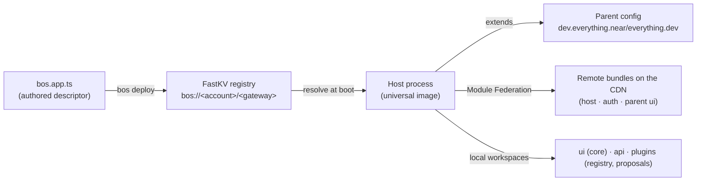
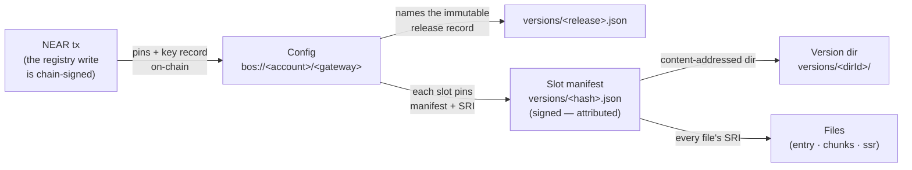
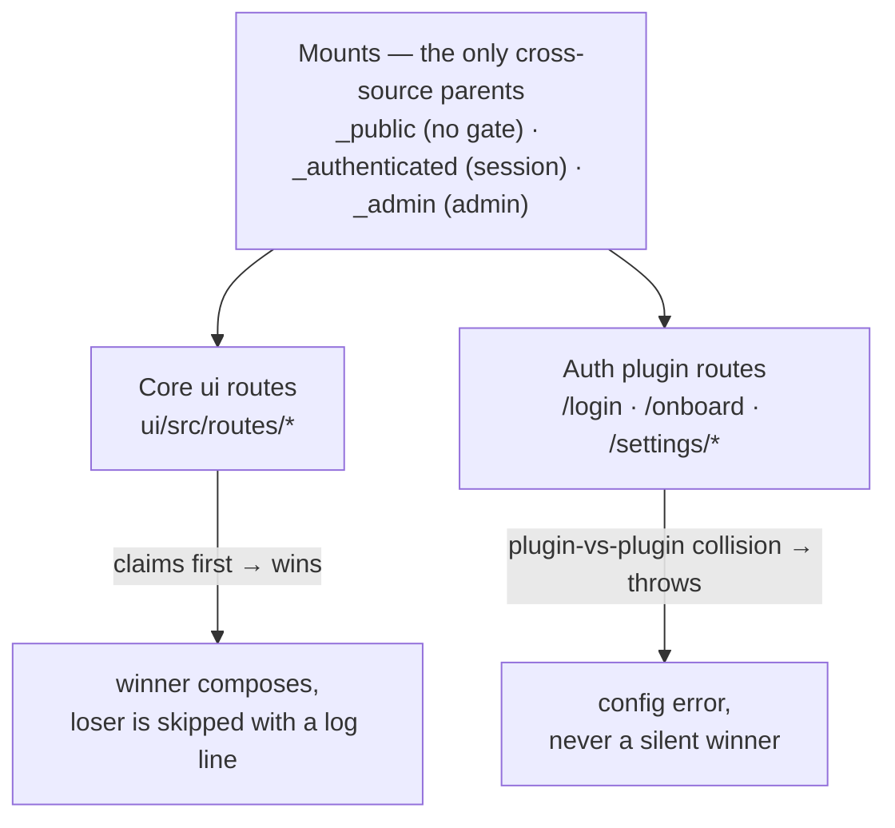
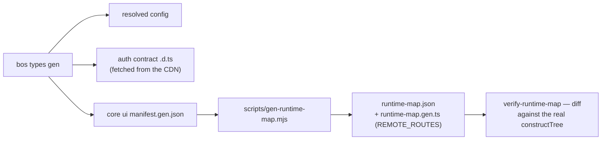

# How it all fits — the everything.dev runtime, drawn

For the human wondering how this app, the framework, and the deployed runtime
connect. Two companions: the runtime map (`docs/agents/runtime-map.md`, with the
generated inventory in `.bos/generated/runtime-map.json` and the typed
`ui/src/lib/runtime-map.gen.ts` — regenerate with `pnpm run types:gen`) is the
**operational** view (what is local vs remote, who owns each path, how to
override) and [`GLOSSARY.md`](../../GLOSSARY.md) is the
domain vocabulary. An agent can teach any
section below interactively (`/teach`) — this file is the reference those
lessons cite.

## The chain: authored → published → resolved → served

One authored file is the whole argument. `bos deploy` publishes your config to
the registry under your NEAR account; the host resolves your config **through
the extends chain** at boot, downloads what the chain says is published, and
runs your local workspaces in-process next to it. `bos.dev.ts` alters the dev
resolution only; `_resolved` in `.bos/bos.resolved-config.json` records what the
resolution produced (regenerate: `pnpm run types:gen`).

## The verification spine

That chain carries its own proof. From the on-chain write to the served byte,
every hop is an attestation — independently checked, nothing trusted
transitively ([ADR 0046](../adr/0046-manifest-attribution.md),
[`GLOSSARY.md`](../../GLOSSARY.md) — "verification spine"):

`bos verify` walks this spine at three depths (`pointer` / `entries` / `files`)
and reports each leg by name: SRI mismatches, schema failures, and — when the
config demands attribution — manifest signatures verified against the key
record the config publishes. The same walker is the adopt transaction's gate
and the smoke gate's in-image leg, so a broken prefix refuses the boot rather
than serving past it. The one primitive underneath is the Verifier engine
(`everything-dev/verify`): every production fetch goes through it, and its
`Verified<T>` brand is how unverified bytes are kept out of the types.

## Composition: mounts, core-wins, shadows

A mount is a gate plus a pathless layout position, declared by a root-level
layout file. Routes from every source parent onto the shared mounts; when the
core claims a path a plugin also claims, **core ui wins** and the plugin's route
is shadowed (a log line, not an error). Composition degrades to a core-only tree
when a plugin bundle is missing — plugin paths then 404 by design, which is why
`pluginPath()` exists.

## Typed by generation, never hand-maintained

Every type surface is derived. `bos types gen` fetches the remote auth contract,
generates the core manifest, and (via `gen-runtime-map.mjs`) emits the typed
composition inventory. `pnpm run verify:runtime-map` proves the static model
still matches the engine. If a remote manifest fetch fails the build is
**loud**: an explicit `UNRESOLVED` beats a silently-shrinking map.

## Read the runtime's own state

Everything above can be **checked, not trusted** — `.bos/` is the runtime's
ledger. Teachings and investigations cite these surfaces; when a doc and the
state disagree, believe the state and fix the doc.

| Surface | What it teaches |
|---|---|
| the generated runtime map (`runtime-map.json` + the typed `REMOTE_ROUTES` module, where a repo produces one) | what composed, from where, who owns each path (regenerate: `pnpm run types:gen`) |
| `bos.resolved-config.json` | the resolution snapshot — each slot with `development`/`production`/`pin`. **Compare it to the published parent** (each slot's `pin.manifest` names a CDN `versions/<hash>.json`; the parent's live config is at `https://<parent-domain>/.well-known/version`) to see which slots are local overrides and which are inherited as-is |
| `logs/dev-latest.log` + dated `logs/dev-*.log` | what **actually ran**: which MF bundles loaded (`auth=https://cdn…`), compose warnings, per-service boot logs. `bos logs` reads it. This is the truth of last resort when a boot behaves differently than its config suggests |
| `platform-manifest.json` | the resolved platform release — what the `platform:` pin actually pulled (source, resolvedAt, manifest) |
| `deploy-state.json` | what was last published (version, apps) — confuses nobody when "is production serving my code?" |
| `sync-backup/<date>/` | pre-upgrade copies of template-owned files you'd edited — the review surface for `--force` resolutions, bounded to the newest 10. The sync baseline itself lives in `bos.lock.json`'s `template.sync` (ADR 0047) |
| `regression/*.json` | cached seeded sessions (`cookies.json`, `seed.json`, …) — why regression specs start signed-in without minting their own |

**Clean up at source.** These are the runtime's artifacts, not yours to hack
around. Logs rotate at the source: every dev boot prunes dated logs beyond
the newest 20 and anything older than a week — across every writer's names,
including the regression stack's `framework-*`/`regression-*` wrappers and
the pre-PID legacy formats the original pruner couldn't see; files touched
within 24h are never pruned (a live session may be appending). Deleting
`.bos/logs/*.log` by hand is always safe too. The regression caches are safe
to wipe whenever fixtures drift: the next run re-seeds them. Anything else
under `.bos/` (`session.json`, `sync-backup/`) is state you regenerate by
re-running the responsible command — when a surface feels stale, regenerate
it in place rather than editing it. `.bos/` is local-only runtime state
(ADR 0047): the only committed artifact is `bos.lock.json`.

## Where source actually lives

| Want to change… | Where |
|---|---|
| A screen this app owns | `ui/src/routes/…` (claim wins) |
| An auth screen (`/login`, `/settings`) | locally **or** upstream `plugins/auth/` — see the runtime map's three ways |
| API behaviour | `api/src/contract.ts` + `index.ts`, or the owning plugin |
| Framework/auth internals | upstream repo → release → `platform:` pin bump |
| AGENTS.md, workflow docs, skills | synced paths — edit **and** upstream (see [`change-placement.md`](change-placement.md)) |

## Going deeper

- **Framework internals worth the dig** (source ships in `.pnpm/*/src`):
  composition engine `every-plugin/src/ui/manifest/construct.ts`; typegen
  `everything-dev/dist/services/codegen/`; path typing
  `@tanstack/router-core/dist/esm/routeInfo.d.ts`; sync/ownership
  `everything-dev/dist/services/scaffold/{sync,ownership}.mjs`; remote route
  manifests are served at `<ui.production>/manifest.gen.json`.
- **Decisions**: upstream ADRs resolve via
  [`docs/adr/README.md`](../adr/README.md).
- **Issues family**: everything-dev #345/#346 (typesafe `to`), #591 (composition
  inspector), #531 (non-gating regression), #577 (docs parity).
- **Learn it interactively**: run `/teach` with a question about any section
  above — lessons are built from this reference and pin their claims to it.
  Teach from **state**: every claim cites the `.bos` surface or code path that
  shows it, and never rests on parametric memory.
